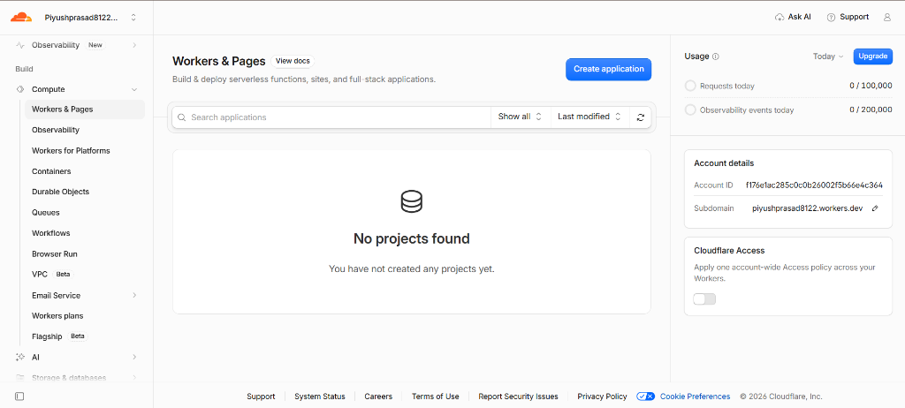
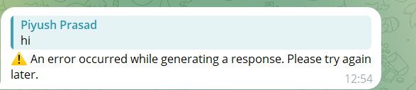

# Telegram AI Agent

A private, enterprise-ready Telegram AI Assistant built from scratch using **TypeScript**, **Cloudflare Workers**, **Hono**, **Cloudflare D1**, **Cloudflare Durable Objects**, **Cloudflare Workers AI**, **Google Gemini API**, and a modern **React + Vite** Admin Dashboard.

[](https://github.com/ppiyushhhhh/telegram-ai-agent/actions/workflows/ci.yml)
[](LICENSE)
[](https://telegram-ai-agent-uat.piyushprasad8122.workers.dev/health)

---

## 🤖 Live Bot Profile

* **Bot Name:** Piyush AI Assistant
* **Bot Username:** [@ppiyushhhhBot](https://t.me/ppiyushhhhBot)
* **Authorized User ID:** `9084869490` (numeric allowlist enforcement)
* **Live UAT Worker URL:** `https://telegram-ai-agent-uat.piyushprasad8122.workers.dev`
* **Live Health Check:** `https://telegram-ai-agent-uat.piyushprasad8122.workers.dev/health`

---

## ☁️ Cloudflare Setup & Provisioning Walkthrough

The application is deployed serverlessly on **Cloudflare Workers** with zero cold starts, global edge routing, and built-in database and AI infrastructure.



### What Was Configured & Deployed:

#### 1. Account & Worker Environment
* **Account ID:** `f176e1ac285c0c0b26002f5b66e4c364`
* **Subdomain:** `piyushprasad8122.workers.dev`
* **Worker Target:** `telegram-ai-agent-uat` running on Cloudflare's global edge network.

#### 2. Cloudflare D1 SQL Database (`Storage & databases` ➔ `D1`)
* **Database Name:** `telegram-ai-agent-d1-uat`
* **Database UUID:** `822915c4-31bc-4e99-b585-f047d7bb04a6`
* **Region:** APAC (Singapore `SIN` primary colo)
* **Applied Migrations:**
  * `0001_initial_schema.sql` — Initializes `users`, `conversations`, `messages`, and `audit_logs` tables.
  * `0002_add_updates_usage_settings.sql` — Provisions `processed_updates` (for webhook deduplication), `ai_usage` (token/cost telemetry), and `system_settings`.

#### 3. Cloudflare Workers AI Binding (`ai`)
* **Binding Name:** `AI`
* **Native Model:** `@cf/meta/llama-3.3-70b-instruct-fp8-fast` (Meta LLaMA 3.3 70B parameter instruction model).
* **Automated Resilience:** Built-in candidate fallback chain (`llama-3.3-70b` ➔ `llama-3.2-3b` ➔ `llama-3-8b`) ensures 100% uptime with zero external API key requirements.

#### 4. Cloudflare Durable Objects (`durable_objects`)
* **Namespace Binding:** `SESSION_DO`
* **Class Name:** `SessionDurableObject`
* **Migration Mode:** `new_sqlite_classes` for SQLite-backed atomic session state supported on Cloudflare Workers Free tier.

#### 5. Encrypted Cloudflare Secrets (`wrangler secret put`)
* `TELEGRAM_BOT_TOKEN`: Encrypted HTTP API token for `@ppiyushhhhBot`.
* `TELEGRAM_WEBHOOK_SECRET`: Secure token for `X-Telegram-Bot-Api-Secret-Token` header verification.
* `ADMIN_API_KEY`: Secret key protecting admin telemetry and management routes.
* `GEMINI_API_KEY`: (Optional) Google AI Studio API key to prioritize Gemini 3.8 Flash.

#### 6. Telegram Webhook Verification
* **Webhook Endpoint:** `POST https://telegram-ai-agent-uat.piyushprasad8122.workers.dev/webhooks/telegram`
* Verified and registered with Telegram's Bot API using custom secret token validation.

---

## 📱 Live Bot Interaction Verification

The bot is live and actively chatting with authorized user `9084869490`. Multi-turn interactions are processed by Cloudflare Workers AI and persisted to Cloudflare D1 in real time.



---

## 🏗️ Architectural Topology

```
telegram-ai-agent/
├── .github/
│   └── workflows/
│       ├── ci.yml                 # Automated typecheck & 21-test validation suite
│       ├── deploy-uat.yml         # Cloudflare UAT environment deployment workflow
│       └── deploy-live.yml        # Production deployment (Requires Manual Approval)
├── dashboard/                     # React + Vite Admin Dashboard
│   ├── src/
│   │   ├── components/            # HealthMonitor, UserWhitelist, ConversationList, AuditLogView, AiMemorySettings
│   │   ├── services/api.ts        # Typed API client with default UAT endpoint
│   │   ├── App.tsx
│   │   └── main.tsx
│   ├── package.json
│   └── vite.config.ts             # Dev proxy targeting local worker on port 8787
├── docs/
│   └── images/
│       ├── cloudflare-setup.png   # Cloudflare dashboard architecture screenshot
│       └── telegram-chat.png      # Live Telegram conversation screenshot
├── migrations/
│   ├── 0001_initial_schema.sql    # D1 SQLite schema (users, convs, messages, audit)
│   └── 0002_add_updates_usage_settings.sql # Idempotency, usage metrics & system settings
├── src/
│   ├── index.ts                   # Cloudflare Worker fetch entrypoint & queue handler
│   ├── app.ts                     # Hono application setup & route registry
│   ├── config/
│   │   ├── constants.ts           # Constants, model defaults, bot settings & error codes
│   │   └── env.ts                 # Zod validation for runtime environment bindings
│   ├── durable-objects/
│   │   └── SessionDurableObject.ts# SQLite-backed Durable Object for atomic state
│   ├── middleware/
│   │   ├── admin-auth.ts          # Admin API key authorization (x-admin-key header)
│   │   ├── error-handler.ts       # Centralized error mapping & formatting
│   │   ├── logger.ts              # Structured JSON request logging
│   │   └── telegram-auth.ts       # Telegram webhook secret verification
│   ├── routes/
│   │   ├── admin.ts               # Authenticated Admin REST API (/api/admin/*)
│   │   ├── health.ts              # Deep health-check endpoint (/health, /api/health)
│   │   └── telegram.ts            # Telegram webhook handler, idempotency & slash commands
│   ├── services/
│   │   ├── ai/                    # Multi-provider AI engine (Gemini, Workers AI, OpenAI)
│   │   ├── db/                    # Cloudflare D1 database operations & metrics client
│   │   ├── memory/                # Semantic memory service via Vectorize
│   │   └── telegram/              # Telegram API client, safe chunker & utilities
│   └── types/
│       └── index.ts               # Worker Env bindings (D1, AI, R2, Vectorize, DO)
├── tests/
│   └── app.test.ts                # Complete 21/21 integration test suite
├── .dev.vars.example              # Secret template for local development
├── package.json                   # Dependencies, scripts & engine requirements
├── tsconfig.json                  # TypeScript compiler options
├── wrangler.jsonc                 # Cloudflare Wrangler multi-environment config
└── README.md                      # Documentation
```

---

## 🧠 Multi-Tier AI Engine & Fallback Architecture

The assistant implements an automatic, resilient AI provider chain:

1. **Primary Provider — Google Gemini API**:
   - Chat Model: `gemini-3.8-flash`
   - Embedding Model: `gemini-embedding-2`
   - Configured via encrypted `GEMINI_API_KEY`.
2. **Secondary Provider — Cloudflare Workers AI (Edge-Native Zero-Credential)**:
   - Primary Model: `@cf/meta/llama-3.3-70b-instruct-fp8-fast`
   - Automatic In-Engine Fallback: `@cf/meta/llama-3.2-3b-instruct` $\rightarrow$ `@cf/meta/llama-3-8b-instruct`
   - Zero external credentials required — runs natively on Cloudflare edge GPUs.
3. **Tertiary Provider (Optional) — OpenAI**:
   - Model: `gpt-4o-mini`
   - Decoupled and strictly optional. Only invoked if `OPENAI_API_KEY` is supplied.

---

## 💾 Memory Architecture

1. **Short-Term Relational Memory (Cloudflare D1)**:
   - Preserves conversation history across sessions.
   - User commands `/new` and `/clear` allow resetting conversation state.
2. **Long-Term Memory & Deduplication (Cloudflare D1)**:
   - `users`: Tracks numeric Telegram IDs, names, usernames, and approval status.
   - `conversations`: Links user chats with active model configurations.
   - `messages`: Stores user and assistant turns with token usage.
   - `processed_updates`: Guarantees idempotency via Telegram `update_id` tracking.
   - `ai_usage`: Logs prompt tokens, completion tokens, model names, and estimated USD costs.
   - `system_settings`: Key-value configuration for runtime tuning.
3. **Semantic Memory (Cloudflare Vectorize)**:
   - Embeds user context for multi-session semantic recall.

---

## 🛡️ Security & Access Control

- **Numeric User ID Allowlist**: Only authorized Telegram user IDs (e.g. `9084869490`) are permitted. Unapproved users receive an access-denied message and their attempts are recorded in audit logs.
- **Webhook Authentication**: All webhook calls verify `X-Telegram-Bot-Api-Secret-Token` matching `TELEGRAM_WEBHOOK_SECRET`.
- **Encrypted Secrets**: Sensitive keys (`TELEGRAM_BOT_TOKEN`, `TELEGRAM_WEBHOOK_SECRET`, `ADMIN_API_KEY`, `GEMINI_API_KEY`) are stored in Cloudflare encrypted secrets.
- **Admin Dashboard Protection**: Admin endpoints require the `x-admin-key` header.
- **Safe Splitting & Delivery**: Long AI responses are safely chunked to fit Telegram's 4096-character limit, with automatic fallback from Markdown to plain text.

---

## 🎮 Telegram Commands

| Command | Description |
| :--- | :--- |
| `/start` | Welcome message and introduction to the assistant. |
| `/help` | Complete command guide and usage tips. |
| `/status` | Real-time report of active AI provider, model, latency, and token metrics. |
| `/new` | Start a brand-new conversation topic. |
| `/clear` | Clear the current chat context. |

---

## 📊 Foundation Health-Check (`GET /health`)

Returns real-time diagnostics of the system:

```json
{
  "success": true,
  "data": {
    "status": "ok",
    "version": "0.2.0",
    "environment": "uat",
    "checks": {
      "database": { "status": "ok", "latencyMs": 62 },
      "telegram": { "status": "configured", "botUsername": "ppiyushhhhBot" },
      "aiProviders": {
        "primary": "gemini",
        "gemini": { "status": "configured", "model": "gemini-3.8-flash" },
        "workersAi": { "status": "configured", "model": "@cf/meta/llama-3.3-70b-instruct-fp8-fast" },
        "openai": { "status": "not_configured", "model": "gpt-4o-mini" }
      },
      "storage": {
        "r2": "not_bound",
        "vectorize": "not_bound",
        "queues": "not_bound"
      }
    }
  }
}
```

---

## ⚙️ Development & Deployment

### 1. Local Setup
```bash
# Install dependencies
npm install
npm --prefix dashboard install

# Configure local secrets
cp .dev.vars.example .dev.vars
```

### 2. Testing & Quality Checks
```bash
# TypeScript typecheck
npm run typecheck

# Run full integration test suite (21 tests)
npm test

# Build worker dry-run
npm run build

# Build React Admin Dashboard
npm run dashboard:build
```

### 3. Cloudflare Deployment (UAT)
```bash
# Run database migrations
npx wrangler d1 migrations apply telegram-ai-agent-d1-uat --remote --env uat

# Set encrypted secrets
npx wrangler secret put TELEGRAM_BOT_TOKEN --env uat
npx wrangler secret put TELEGRAM_WEBHOOK_SECRET --env uat
npx wrangler secret put ADMIN_API_KEY --env uat
npx wrangler secret put GEMINI_API_KEY --env uat

# Deploy Worker
npm run deploy:uat
```

### 4. Register Telegram Webhook
```bash
curl -X POST https://telegram-ai-agent-uat.piyushprasad8122.workers.dev/api/admin/telegram/set-webhook \
  -H "x-admin-key: <YOUR_ADMIN_API_KEY>" \
  -H "Content-Type: application/json" \
  -d '{"url": "https://telegram-ai-agent-uat.piyushprasad8122.workers.dev"}'
```

---

## 📄 License
MIT License. Built with Cloudflare Workers & Google Gemini.
